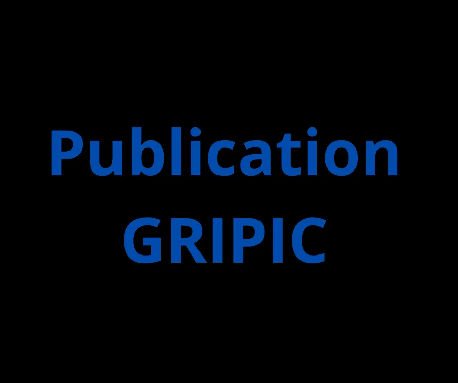

## Informations sur la publication

- **Auteurs:** Asmaa Azizi
- **Type de publication:** thesis
- **Éditeur:** Paris 4
- 🔗 **Lien HAL / Publication:** [https://hal.science/tel-04972713](https://hal.science/tel-04972713)

